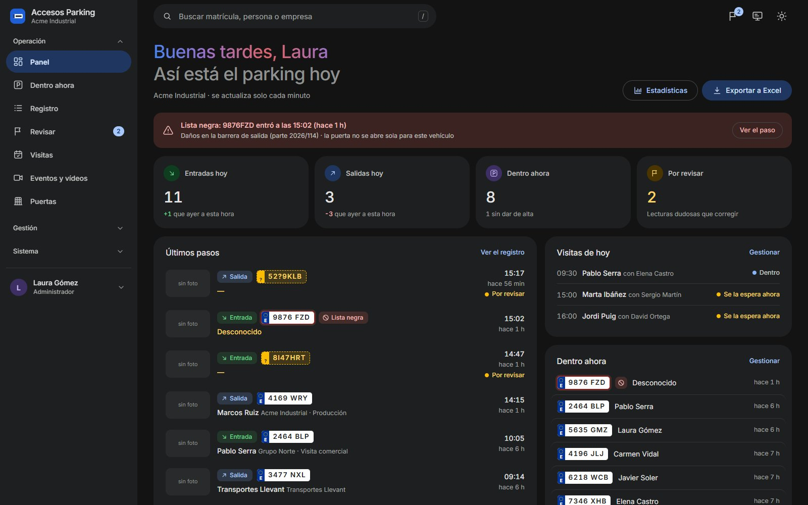
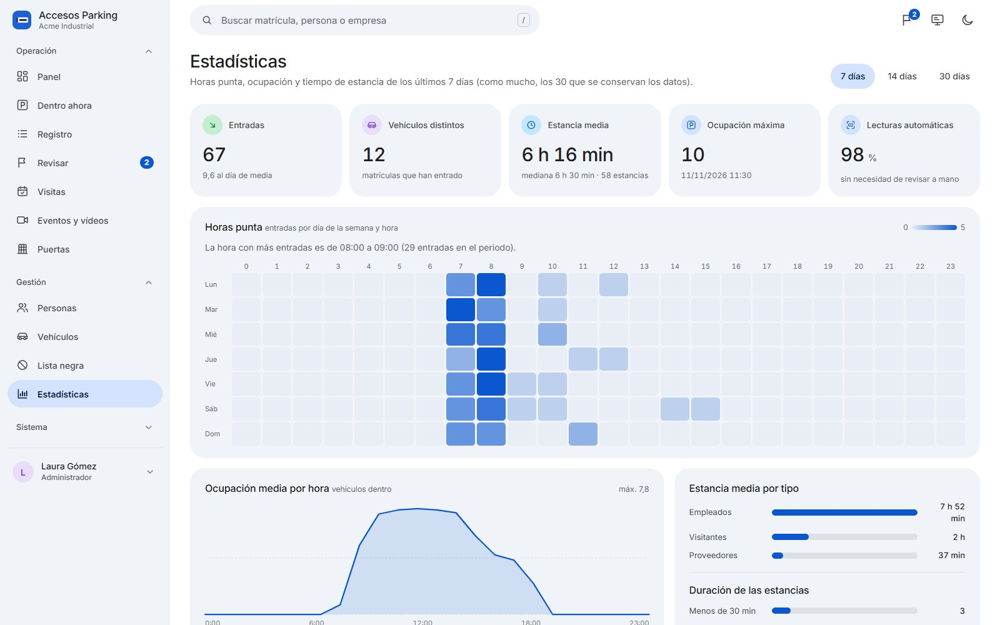
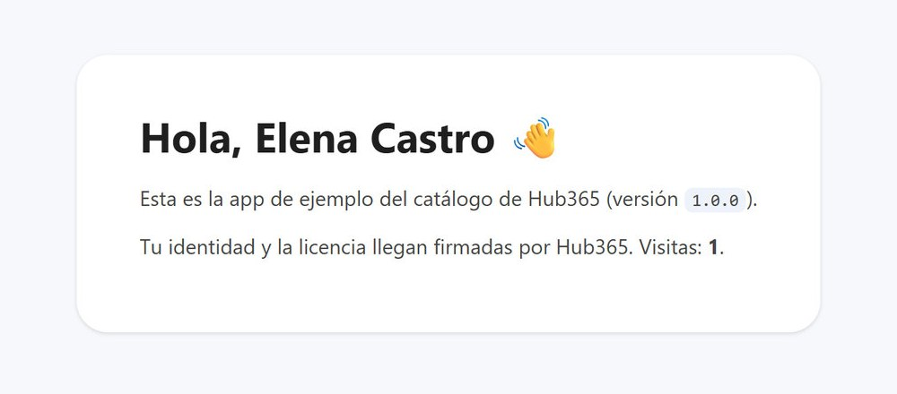

  

<h1 align="center">Hub365 App Catalog</h1>

  Apps by <strong>NextCode Agency</strong>, ready to install in your Hub365 with one click. 
  Verified, connected to your users and always up to date.

  
  
  

  <a href="README.md">Español</a> · <strong>English</strong>

  

---

## What it is

Hub365 comes with its own **App catalog** (*Applications › App catalog*). From there you see the apps in
this catalog, read their details and install them without touching the command line. Once installed:

- They show up in **Applications** and in your employees' **portal**, like any other app.
- **They know who's signing in**: they use the Hub365 session, with no separate users or passwords.
- **They update** from the same catalog, and your data is kept.
- Hub365 **checks that the catalog is genuine** before showing it: if anyone tampered with it, it wouldn't
  be shown.

## Available apps

| | App | What it's for | What it needs |
|:-:|---|---|---|
| 🚗 | [**Parking Access**](#-parking-access) | Parking entries and exits by number plate, gate opening and alerts | Hub365 on Windows or Linux, and Docker for the app |
| ✅ | [**Approvals**](#-approvals) | Approval workflows: request types with a form, stages, working-hour deadlines, absences, notifications and a PDF receipt | Hub365 on Windows or Linux, and Docker for the app |
| 📚 | [**Documentation**](#-documentation) | Document management: shelves, books and pages with an editor, uploaded documents, revisions and search | Hub365 on Windows or Linux, and Docker for the app |
| 👋 | [**Hello Hub365**](#-hello-hub365) | Sample app to see how the catalog works | Hub365 on Windows or Linux, nothing else |

### 🚗 Parking Access

Automatic log of **parking entries and exits by number plate**, from your cameras and Frigate (an NVR
with AI detection). You always know who's inside and since when, and gates can open on their own for
authorized vehicles.

<table>
  <tr>
    <td width="50%"></td>
    <td width="50%"></td>
  </tr>
  <tr>
    <td align="center">Dashboard (dark theme): today's activity compared with yesterday, blacklist alert, visitors and who's inside</td>
    <td align="center">Statistics (light theme): peak hours, hourly occupancy and length of stay</td>
  </tr>
</table>

- **Every passage logged** with number plate, photo and reading confidence; doubtful ones are kept for review.
- **Second reading**: if the camera misreads the plate, the app reads it again from the video.
- **People and vehicles** by type (employee, visitor, supplier…), with automatic gate opening by type and
  hours (iSmartGate / Gogogate2, Home Assistant, Tasmota or webhook).
- **Quick search, blacklist and visitors**: a blacklisted plate shows in red, raises an alert when it comes in
  and the gate won't open on its own; pre-registered visitors aren't flagged as unknown and you see who
  they're visiting.
- **Statistics and reception screen**: peak hours, occupancy and length of stay, plus a full-screen view
  for the gatehouse that refreshes on its own.
- **Alerts** through Microsoft Teams or webhook, plus Home Assistant integration.
- **Data protection**: passages and photos are deleted automatically after 30 days.
- **Everything is set up from the web**: cameras, recorder, gates, users and an installation guide.
- **Light or dark theme** and mobile-friendly, with the same look as Hub365.

**Requires:** Hub365 2.3 or later (Windows or Linux), Docker for the app's container (about 2 GB of RAM)
and Frigate 0.16 or later with number plate recognition. → [Full details](apps/accesos-parking/README.en.md)

### ✅ Approvals

Approval workflows with **request types** (form, stages and versions), **deadlines** in working hours and a
**PDF receipt** that can be verified.

- **Forms and flows**: 25 field types, calculated fields and conditions; stages with a person, a group, the
  manager, the head of the department or an authority matrix, in parallel, with a quorum or one after another; a
  simulator and 10 built-in templates.
- **Deciding**: approve, reject, return for changes, reassign, consult, sign and approve several at once.
- **Deadlines and absences**: calendars with holidays, reminders, escalation and substitutes while you are away.
- **Notifications**: bell, email with "Review and decide", daily digest, Microsoft Teams and webhooks.
- **Hash chain** on every request, **reports** with CSV and Excel export, an **API** with tokens, **audit log**
  and **backups**.
- With **Hub365 2.4** it uses Hub365's directory (with job title and manager), its bell and its email.

**Needs:** Hub365 2.3 or later (Windows or Linux) and Docker for the app container.
→ [Full details](apps/aprobaciones/README.en.md)

### 📚 Documentation

Your company's documentation organised like a library: **shelves, books, chapters and pages**, with a full
editor and each topic's **documents** (PDF, Word, Excel, images…) in the same place.

- **Full editor**: tables, task lists, callouts, code, pasted images, embedded PDFs and links between pages.
- **Documents**: attachments on every page, a tab with all of a book's files and **multi-upload** where each
  file becomes a page (Word, Markdown, HTML, text, PDF…).
- **Revisions, drafts and templates**: compare and restore versions, automatic draft while you type, a notice
  when someone else is editing the same page, and built-in or your own templates.
- **Search** in the content and in the text of attached PDFs and Word files; **import and export** (HTML,
  Markdown, ZIP, printing) and a **trash**.
- **Who sees what** by Hub365 department, **audit log** and **backups**.

**Needs:** Hub365 2.3 or later (Windows or Linux) and Docker for the app container.
→ [Full details](apps/documentacion/README.en.md)

### 👋 Hello Hub365

A small app that greets whoever opens it by their Hub365 name. It shows in a minute how a catalog app is
installed, opened and updated.

  

**Requires:** Hub365 2.2 or later, on Windows or Linux. → [Full details](apps/hola-hub365/README.en.md)

## Installing an app

1. In Hub365, go to **Applications › App catalog**.
2. Open the app's **Details** to see what it does and what it needs.
3. Click **Install**. When it finishes, the app is already in your portal.

Docker apps install on their own if Hub365 controls Docker on your server; if not, Hub365 gives you the
`compose` file ready to start it.

## Licensing

Every app in the catalog needs a **Hub365 license that includes it**. In the catalog, each app shows
whether your license already includes it.

The apps are proprietary software of NextCode Agency: they may not be copied, redistributed or modified, or
used without a license that includes them. The full terms are in [LICENSE](LICENSE).

## Contact

Want to get an app, extend your license or ask for a demo?

✉️ **[info@nextcodeagency.com](mailto:info@nextcodeagency.com)** 
🌐 [nextcodeagency.com](https://nextcodeagency.com) 
⬇️ Download Hub365: [HUB365-Releases](https://github.com/Rannden-SHA/HUB365-Releases)

---

  © 2026 NextCode Agency · Screenshots show a fictitious demo company (Spanish interface).

