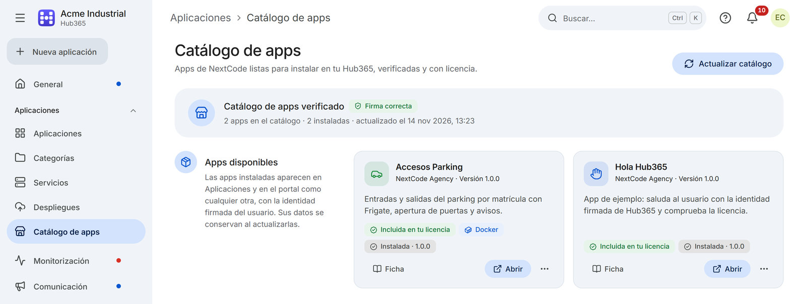
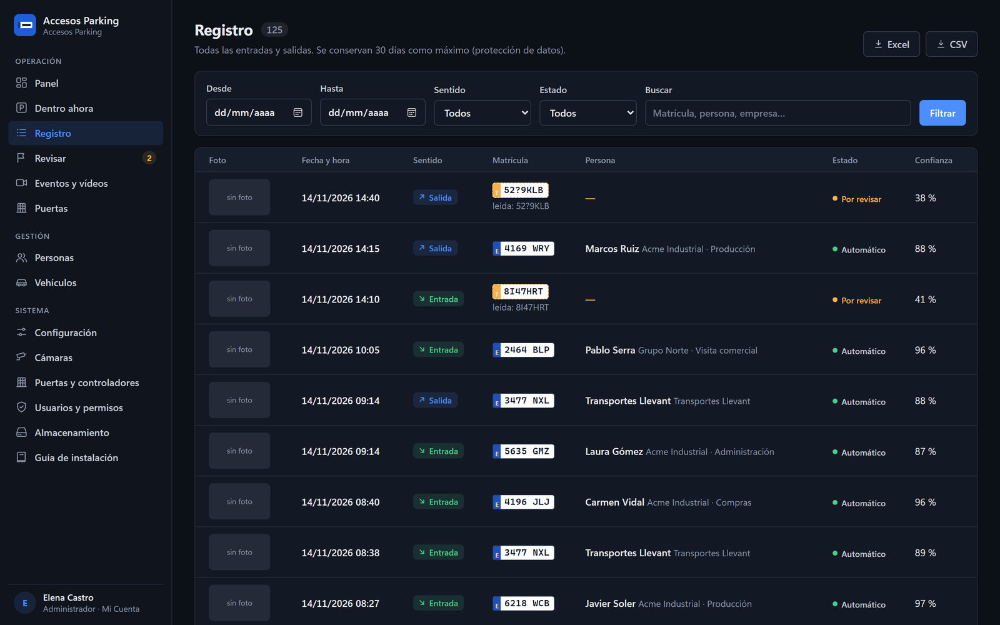

  

<h1 align="center">Hub365 App Catalog</h1>

  Apps by <strong>NextCode Agency</strong>, ready to install in your Hub365 with one click. 
  Verified, connected to your users and always up to date.

  
  
  

  <a href="README.md">Español</a> · <strong>English</strong>

  

---

## What it is

Hub365 comes with its own **App catalog** (*Applications › App catalog*). From there you see the apps in
this catalog, read their details and install them without touching the command line. Once installed:

- They show up in **Applications** and in your employees' **portal**, like any other app.
- **They know who's signing in**: they use the Hub365 session, with no separate users or passwords.
- **They update** from the same catalog, and your data is kept.
- Hub365 **checks that the catalog is genuine** before showing it: if anyone tampered with it, it wouldn't
  be shown.

## Available apps

| | App | What it's for | Runs on |
|:-:|---|---|---|
| 🚗 | [**Parking Access**](#-parking-access) | Parking entries and exits by number plate, gate opening and alerts | Linux with Docker |
| 👋 | [**Hello Hub365**](#-hello-hub365) | Sample app to see how the catalog works | Windows and Linux |

### 🚗 Parking Access

Automatic log of **parking entries and exits by number plate**, from your cameras and Frigate (an NVR
with AI detection). You always know who's inside and since when, and gates can open on their own for
authorized vehicles.

<table>
  <tr>
    <td width="50%"></td>
    <td width="50%"></td>
  </tr>
  <tr>
    <td align="center">Dashboard: today's activity, who's inside and the last 7 days</td>
    <td align="center">Passage log, with filters and Excel export</td>
  </tr>
</table>

- **Every passage logged** with number plate, photo and reading confidence; doubtful ones are kept for review.
- **Second reading**: if the camera misreads the plate, the app reads it again from the video.
- **People and vehicles** by type (employee, visitor, supplier…), with automatic gate opening by type and
  hours (iSmartGate / Gogogate2, Home Assistant, Tasmota or webhook).
- **Alerts** through Microsoft Teams or webhook, plus Home Assistant integration.
- **Data protection**: passages and photos are deleted automatically after 30 days.
- **Everything is set up from the web**: cameras, recorder, gates, users and an installation guide.

**Requires:** Hub365 2.2 or later on Linux with Docker (about 2 GB of RAM) and Frigate 0.14 or later with
number plate recognition. → [Full details](apps/accesos-parking/README.en.md)

### 👋 Hello Hub365

A small app that greets whoever opens it by their Hub365 name. It shows in a minute how a catalog app is
installed, opened and updated.

  

**Requires:** Hub365 2.2 or later, on Windows or Linux. → [Full details](apps/hola-hub365/README.en.md)

## Installing an app

1. In Hub365, go to **Applications › App catalog**.
2. Open the app's **Details** to see what it does and what it needs.
3. Click **Install**. When it finishes, the app is already in your portal.

Docker apps install on their own if Hub365 controls Docker on your server; if not, Hub365 gives you the
`compose` file ready to start it.

## Licensing

Every app in the catalog needs a **Hub365 license that includes it**. In the catalog, each app shows
whether your license already includes it.

## Contact

Want to get an app, extend your license or ask for a demo?

✉️ **[info@nextcodeagency.com](mailto:info@nextcodeagency.com)** 
🌐 [nextcodeagency.com](https://nextcodeagency.com) 
⬇️ Download Hub365: [HUB365-Releases](https://github.com/Rannden-SHA/HUB365-Releases)

---

  © 2026 NextCode Agency · Screenshots show a fictitious demo company (Spanish interface).

