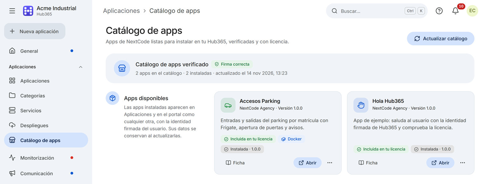
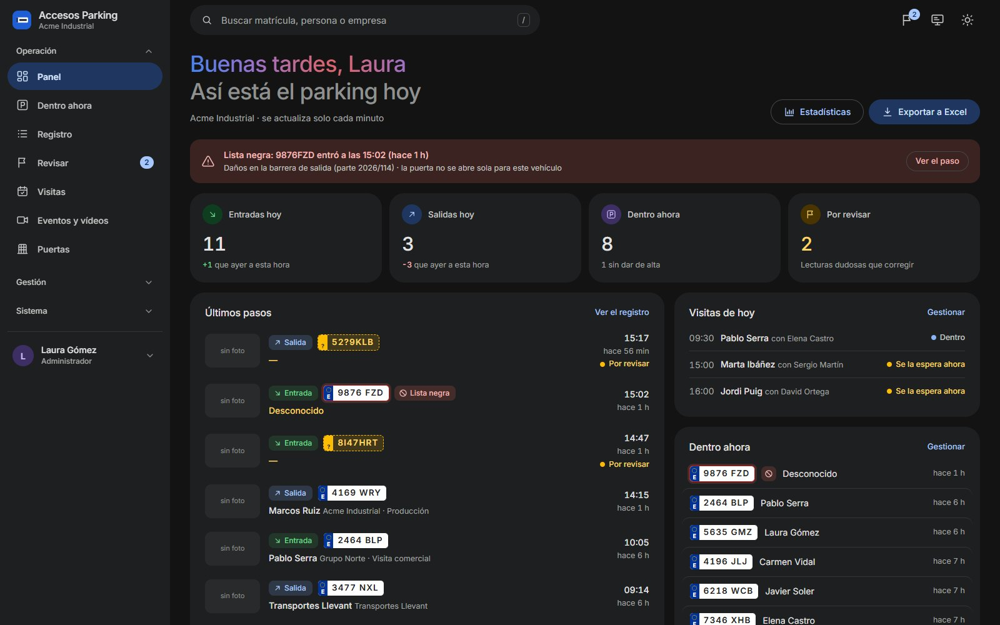
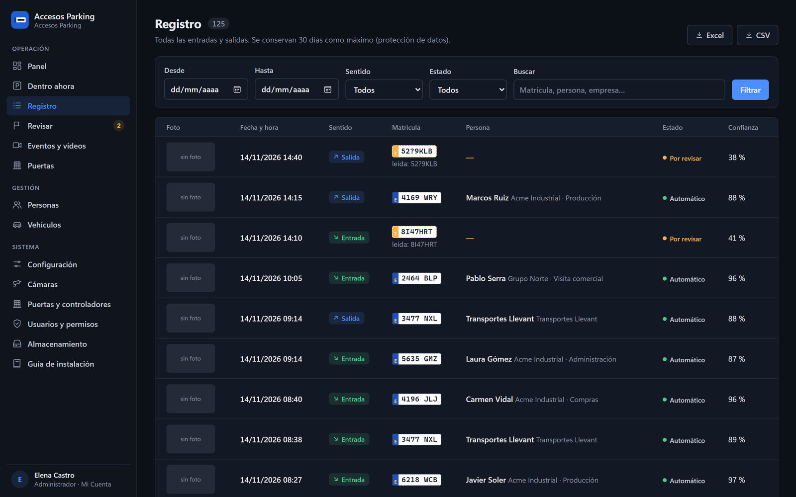
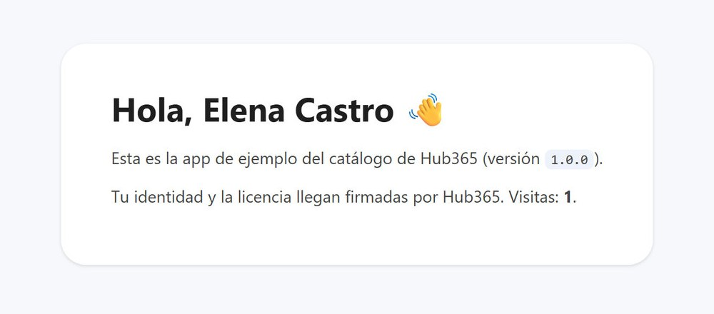

  

<h1 align="center">Catálogo de apps de Hub365</h1>

  Aplicaciones de <strong>NextCode Agency</strong> listas para instalar en tu Hub365 con un clic. 
  Verificadas, integradas con tus usuarios y siempre al día.

  
  
  

  <strong>Español</strong> · <a href="README.en.md">English</a>

  

---

## Qué es

Hub365 trae su propio **Catálogo de apps** (*Aplicaciones › Catálogo de apps*). Desde ahí ves las apps de
este catálogo, lees su ficha y las instalas sin tocar la línea de comandos. Una vez instaladas:

- Aparecen en **Aplicaciones** y en el **portal** de tus empleados, como cualquier otra.
- **Saben quién entra**: usan la sesión de Hub365, sin usuarios ni contraseñas aparte.
- **Se actualizan** desde el mismo catálogo, y tus datos se conservan.
- Hub365 **comprueba que el catálogo es auténtico** antes de enseñarlo: si alguien lo alterase, no lo
  mostraría.

## Apps disponibles

| | App | Para qué sirve | Qué necesita |
|:-:|---|---|---|
| 🚗 | [**Accesos Parking**](#-accesos-parking) | Entradas y salidas del parking por matrícula, apertura de puertas y avisos | Hub365 en Windows o Linux, y Docker para la app |
| 👋 | [**Hola Hub365**](#-hola-hub365) | App de ejemplo para conocer cómo funciona el catálogo | Hub365 en Windows o Linux, nada más |

### 🚗 Accesos Parking

Registro automático de las **entradas y salidas del parking por matrícula**, a partir de tus cámaras y de
Frigate (NVR con detección por IA). Sabes en todo momento quién está dentro y desde cuándo, y las puertas
se pueden abrir solas para los vehículos autorizados.

<table>
  <tr>
    <td width="50%"></td>
    <td width="50%"></td>
  </tr>
  <tr>
    <td align="center">Panel: actividad del día, quién está dentro y últimos 7 días</td>
    <td align="center">Registro de pasos, con filtros y exportación a Excel</td>
  </tr>
</table>

- **Registro de cada paso** con matrícula, foto y fiabilidad de la lectura; los dudosos quedan para revisar.
- **Segunda lectura**: si la cámara no lee bien la matrícula, la app la vuelve a leer en el vídeo.
- **Personas y vehículos** por tipo (empleado, visita, proveedor…), con apertura automática de puertas por
  tipo y horario (iSmartGate / Gogogate2, Home Assistant, Tasmota o webhook).
- **Avisos** por Microsoft Teams o webhook, e integración con Home Assistant.
- **Protección de datos**: los pasos y las fotos se borran solos a los 30 días.
- **Todo se configura desde la web**: cámaras, grabador, puertas, usuarios y una guía de instalación.

**Necesita:** Hub365 2.2 o posterior (Windows o Linux), Docker para el contenedor de la app (unos 2 GB
de RAM) y Frigate 0.14 o posterior con lectura de matrículas. → [Ficha completa](apps/accesos-parking/README.md)

### 👋 Hola Hub365

Una app pequeña que saluda a quien la abre con su nombre de Hub365. Sirve para ver en un minuto cómo se
instala, se abre y se actualiza una app del catálogo.

  

**Necesita:** Hub365 2.2 o posterior, en Windows o Linux. → [Ficha completa](apps/hola-hub365/README.md)

## Cómo se instala una app

1. En Hub365, entra en **Aplicaciones › Catálogo de apps**.
2. Abre la **Ficha** de la app para ver qué hace y qué necesita.
3. Pulsa **Instalar**. Cuando termine, la app ya está en tu portal.

Las apps de Docker se instalan solas si Hub365 controla Docker en tu servidor; si no, Hub365 te da el
fichero `compose` listo para arrancarla.

## Licencias

Cada app del catálogo necesita una **licencia de Hub365 que la incluya**. En el catálogo, cada app indica si
tu licencia ya la incluye.

## Contacto

¿Quieres contratar una app, ampliar tu licencia o pedir una demostración?

✉️ **[info@nextcodeagency.com](mailto:info@nextcodeagency.com)** 
🌐 [nextcodeagency.com](https://nextcodeagency.com) 
⬇️ Descarga Hub365: [HUB365-Releases](https://github.com/Rannden-SHA/HUB365-Releases)

---

  © 2026 NextCode Agency · Las capturas muestran una empresa ficticia de demostración.

